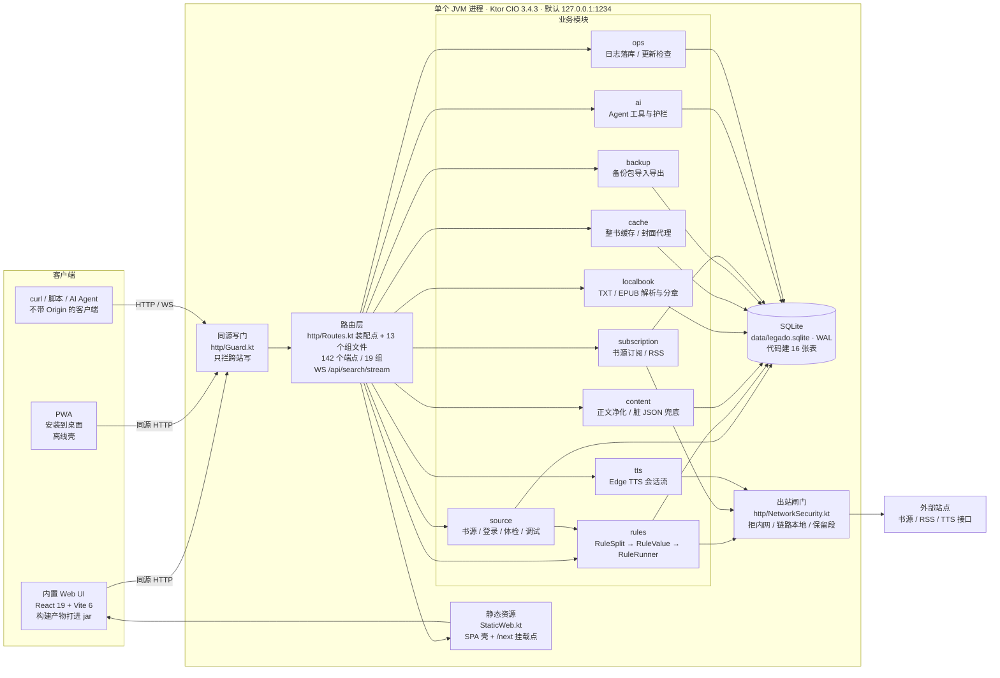
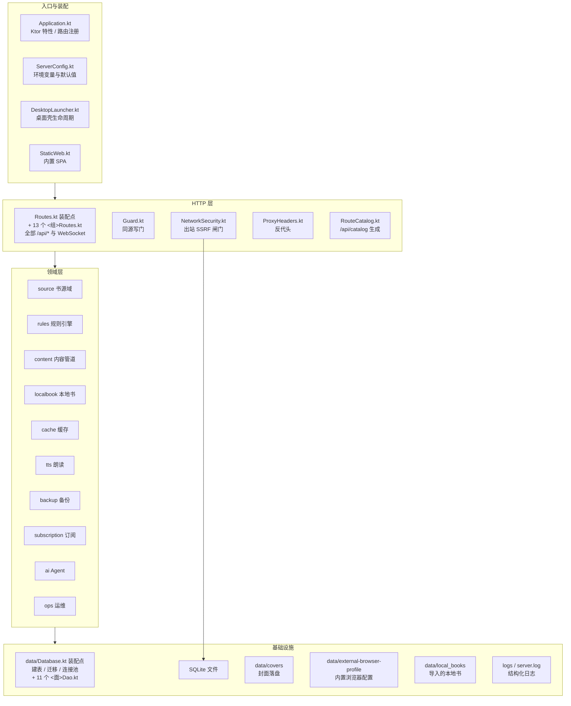
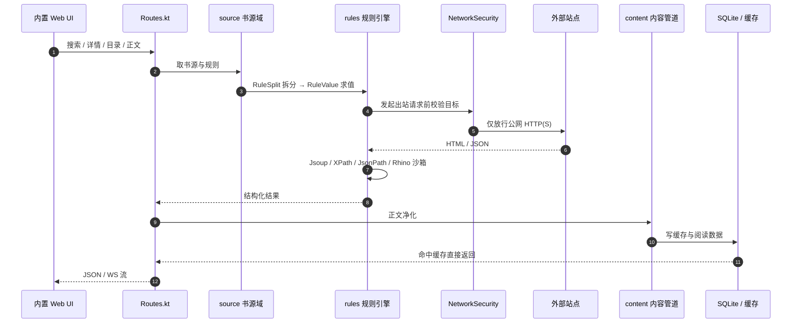
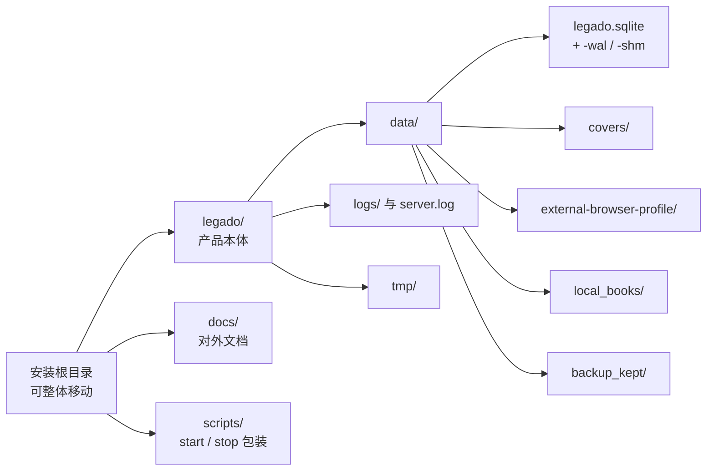
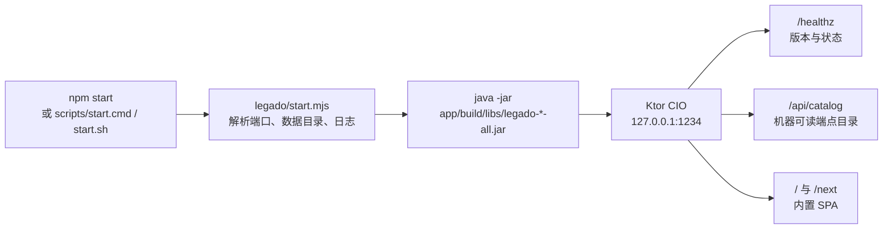
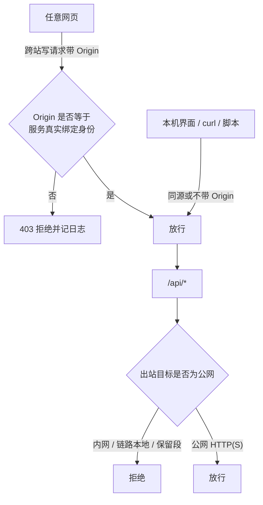

# 架构示意

> 依据当前 1234 的源码与运行态整理，只画已经存在的部分。**这里不写版本号也不写端点数** ——
> 版本以 `/healthz` 为准、端点以 `/api/catalog` 为准（`docs/API-REFERENCE.md` 由契约生成）。
> 抄一份数字在这里，下次发版就多一处会忘记改的地方（0.8.2→0.8.3 那轮就集体滞后过）。
> 接口清单见 [`API-REFERENCE.md`](API-REFERENCE.md)，目录职责见 [`STRUCTURE.md`](STRUCTURE.md)。

## 1. 全景



## 2. 后端分层



## 3. 一条开书链路



搜索走 `WS /api/search/stream`：多书源并发，结果边到边推，可中途停止；其余环节走普通 HTTP。

## 4. 数据与文件



| 位置 | 内容 | 是否入库 |
|---|---|---|
| `legado/data/legado.sqlite` | 书源、书架、进度、缓存索引、日志等（代码建 16 张表；老库里可能还有已停用的旧表） | 否 |
| `legado/data/covers/` | 封面文件 | 否 |
| `legado/data/external-browser-profile/` | 内置浏览器登录态 | 否 |
| `legado/data/local_books/` | 导入的 TXT / EPUB | 否 |
| `legado/data/backup_kept/` | 备份包里没有原生归宿的条目 | 否 |
| `legado/logs/`、`legado/server.log` | 运行日志 | 否 |

## 5. 启动与进程



- 端口优先级：`--port` → `port.txt` → `.env` / `LEGADO_PORT` → `1234`。`port.txt` 排第二是因为它是
  使用者在界面上最后改的那一下（`PUT /api/server/port` 写的就是它），比一份可能早就不记得的 `.env` 更算数。
  注意服务端自己的兜底默认是 `8080`（`ServerConfig.kt`），`1234` 是 `scripts/runtime.mjs` 这个启动器给的 ——
  裸跑 jar 不经过启动器时，缺省端口是 8080 而不是 1234。
- 数据与日志都相对安装根解析，换盘或改名后无需改配置。
- 停止用 `npm run stop`（`legado/stop.mjs`），只结束本目录启动的进程。

## 6. 安全边界



| 边界 | 规则 |
|---|---|
| 监听地址 | 默认 `127.0.0.1`；改 `LEGADO_HOST=0.0.0.0` 等于把整库交给局域网 |
| 身份认证 | 没有账号、密码、会话 |
| 写保护 | `POST` / `PUT` / `DELETE` 要求同源 `Origin` |
| 出站 | 只允许公网 HTTP(S)，阻止内网与保留地址 |
| 静态资源 | 由 jar 内资源提供，SPA 壳与 `/next` 挂载点同源 |

## 7. 代码地图

| 目录 | 职责 | 关键文件 |
|---|---|---|
| `legado/app/src/main/kotlin/io/legado/` | 入口与装配 | `Application.kt`、`ServerConfig.kt`、`StaticWeb.kt`、`BuildInfo.kt`、`DesktopLauncher.kt` |
| `legado/app/src/main/kotlin/io/legado/http/` | 路由、写门、出站闸门、目录生成 | `Routes.kt` 装配点 + 13 个组文件（`SourcesRoutes`/`SearchRoutes`/`SubscriptionsRoutes`/`BackupRoutes`/`RssRoutes`/`ReadingRoutes`/`ReplaceRulesRoutes`/`ShelfRoutes`/`TocRulesRoutes`/`MediaRoutes`/`ProgressRoutes`/`TtsRoutes`/`AgentApiRoutes`，共 14 个 `*Routes.kt` 含装配点本身）、`Guard.kt`、`NetworkSecurity.kt`、`RouteCatalog.kt` |
| `legado/app/src/main/kotlin/io/legado/rules/` | 规则解析与求值 | `RuleRunner.kt`、`RuleSplit.kt`、`RuleValue.kt`、`JsSandbox.kt`、`PagingRule.kt` |
| `legado/app/src/main/kotlin/io/legado/source/` | 书源、登录、体检、调试 | `SourceCodec.kt`、`SourceHealth.kt`、`SourceDebugger.kt`、`WebViewProxy.kt`、`ExternalBrowserLogin.kt` |
| `legado/app/src/main/kotlin/io/legado/content/` | 正文净化 | `ContentPipeline.kt`、`ContentProcessor.kt`、`LooseJson.kt` |
| `legado/app/src/main/kotlin/io/legado/localbook/` | TXT / EPUB | `LocalBookParser.kt`、`TxtTocRule.kt` |
| `legado/app/src/main/kotlin/io/legado/cache/` | 整书缓存与封面 | `BookCacheService.kt`、`CoverCache.kt` |
| `legado/app/src/main/kotlin/io/legado/tts/` | 朗读 | `EdgeTtsService.kt`、`TtsSessionService.kt` |
| `legado/app/src/main/kotlin/io/legado/backup/` | 备份 | `BackupImporter.kt`、`BackupStore.kt`、`LegacyBackup.kt` |
| `legado/app/src/main/kotlin/io/legado/subscription/` | 书源订阅与 RSS | `SubscriptionService.kt` |
| `legado/app/src/main/kotlin/io/legado/ai/` | 进程内 AI 网关 | `Agent.kt` 实现 · `AgentConnection.kt` 句柄 · `AgentRoutes.kt` 薄收口 · `LlmProvider.kt` / `ToolRegistry.kt` / `ConnectionSelector.kt` 扩展点 · `Guardrails.kt` · `BuiltinTools.kt` · `AgentCatalog.kt` 契约 |
| `legado/app/src/main/kotlin/io/legado/plugin/` | 进程内插件框架 | `Plugin.kt`、`PluginManager.kt`、`EventBus.kt`、`AppEvents.kt` |
| `legado/app/src/main/kotlin/io/legado/ops/` | 日志与更新检查 | `LogService.kt`、`UpdateCheck.kt` |
| `legado/app/src/main/kotlin/io/legado/data/` | 建表、迁移、连接池 + 各数据面 | `Database.kt` 装配点 + 11 个 `<面>Dao.kt`（同包扩展函数） |
| `legado/app/src/main/kotlin/io/legado/model/` | 请求 / 响应体 | `Models.kt` |
| `legado/web/src/` | 内置 UI | `app/`（路由表 + 页面渲染表）、`pages/`、`reader/`、`shelf/`、`sources/`、`settings/`、`components/`、`lib/`、`lab/`（容器）、`extensions/`（插件契约）、`plugins/`（内置插件）、`features/`（功能条目） |

## 8. 接口分组

`/api/catalog` 当前返回 142 条，按 19 组分布：

| 分组 | 条数 | 分组 | 条数 |
|---|---:|---|---:|
| 书架 | 16 | 内置浏览器 | 17 |
| 书源 | 12 | 登录与凭据 | 11 |
| 净化规则 | 10 | 朗读 | 9 |
| 进度与笔记 | 9 | AI 自定义接入 | 8 |
| 系统 | 8 | 分章规则 | 7 |
| RSS | 7 | 图片与媒体 | 6 |
| 书源订阅 | 5 | 发现页 | 3 |
| 阅读 | 5 | 离线缓存 | 3 |
| 备份 | 3 | 搜索 | 2 |
| 目录 | 1 |  |  |

逐条路径与方法见 [`API-REFERENCE.md`](API-REFERENCE.md)。

---

## 详细架构（并入自原 ARCHITECTURE-DETAILED.md）

## 0. 系统定位

一台机器上跑的单进程本地阅读服务：**Kotlin/Ktor 后端 + 同源内置 Web UI**，数据落本地 SQLite 与文件系统，默认只监听 `127.0.0.1:1234`，无账号无 token。

```
浏览器 / PWA / curl / AI 客户端
        │  HTTP + WebSocket（默认回环）
        ▼
┌──────────────────────────────────────────────────────────────┐
│ 单个 JVM 进程（Ktor CIO 3.4.3）                              │
│                                                              │
│  SameOriginWriteGate（全局插件，拦跨站写）                    │
│  ─────────────────────────────────────────────────────────  │
│  Routes.kt 装配点 + 13 个域路由文件（142 端点 / 19 组）        │
│  ─────────────────────────────────────────────────────────  │
│  领域层：source · rules · content · localbook · cache ·       │
│          tts · subscription · backup · ops · ai · plugin     │
│  ─────────────────────────────────────────────────────────  │
│  ReadingRepository（阅读域收口）                              │
│  ─────────────────────────────────────────────────────────  │
│  data/*Dao.kt（表级扩展函数） → Database（单写连接 + 读池）    │
└──────────────────────────────────────────────────────────────┘
        │                        │
        ▼                        ▼
  SQLite（WAL，18 张表）     文件：封面 / 本地书 / 日志 / 浏览器 profile
        │
        ▼ 出站（NetworkSecurity 闸门）
  书源站点 / RSS / TTS / 外部模型
```

---

## 1. 进程与启动序列

入口 `legado/app/src/main/kotlin/io/legado/Application.kt` → `Application.legadoApplication(config)`。启动顺序是有依赖的，不能随便调：

| 步 | 动作 | 为什么是这个顺序 |
|---:|---|---|
| 1 | `ServerIdentity.init(host, port)` | 同源写门比对的是「服务自己是谁」，必须早于任何请求 |
| 2 | `LogService.initialize(dbPath)` | 日志要落库，先于数据库构造 |
| 3 | `Database(path)` + `initialize()` | 建表、迁移、按碎片率决定 `VACUUM` |
| 4 | `SubscriptionService` / `RuleRunner` | 依赖 Database |
| 5 | `CoverCache` → `BookCacheService` | 封面缓存必须先于整书缓存：离线缓存漫画章节时要顺手抓图进同一个磁盘缓存 |
| 6 | `EdgeTtsService` → `TtsSessionService` | 会话服务依赖引擎 |
| 7 | `AgentModule.connect(...)` | 进程内 AI 网关，**不开端口、不注册路由**；注入的是与 HTTP 端点**同一份**服务实例 |
| 8 | `PluginManager(...)` | 四个扩展点照旧接线；`LEGADO_PLUGIN_JAR_SCAN` 默认 false，不扫 `plugins/` 的 jar |
| 9 | `install(ContentNegotiation / WebSockets / StatusPages)` | 序列化、WS、异常映射 |
| 10 | `install(SameOriginWriteGate)` | 全局写门，必须在 `routing {}` 之前 |
| 11 | `routing { get("/healthz"); apiRoutes(...) }` | 全部业务端点 |

**线程模型**：Ktor CIO 协程调度；阻塞式 I/O（SQLite、文件、`java.net.http`）用 `withContext(Dispatchers.IO)` 切走；缓存任务用协程 + `Semaphore` 限并发；前端排版用 Web Worker（另一条线，见 §6）。

---

## 2. 分层与依赖规则

```
Route（http/*Routes.kt）
   │  只解析入参、调域方法、把结果包成 HTTP
   ▼
Repository（reading/ReadingRepository）
   │  业务组合；不拼 SQL
   ▼
DAO（data/*Dao.kt，全是 Database 的扩展函数）
   │  表级 CRUD
   ▼
Database（data/Database.kt）
```

三条纪律（写在新代码里要遵守，也是 code review 的判据）：

1. **DAO 只做表级操作**；跨表业务查询收口到 Repository。
2. **Route / Service 不直接拼 SQL**。
3. **依赖方向单向**：前端「内容 → 框架」（`settingsSections.ts` 是设置分区数据的权威源，页面反过来 import 它，不许反过来）。

`ReadingRepository` 目前覆盖：进度、阅读记录、笔记/划线/书签、本书检索、章节窗口。其余域（书源、订阅、缓存…）仍是 Route → DAO 直连，**尚未收口**（见 §12）。

### 2.1 域准入规则

什么算一个「域」、域与域之间怎么划界，靠下面五条判定。它们是**准入条件**，不是风格建议：

1. **一个域 = 一张路由文件 + 一组 DAO + （可选）一个 Repository**，装配入口固定为 `fun Route.xxxRoutes(deps)`。
2. **跨域复用必须有第二个消费方**。只有一处用到的东西留在原域，不许"为省一次 import"搬进公共包 —— 公共包一旦长成杂物间，就再也分不清谁能删。
3. **`Routes.kt` 只构造依赖并调用域入口**。新增域**不改中央签名**；若发现必须改，说明依赖没归位。
4. **依赖方向单向**：领域服务不反向依赖 `ai/` 或 `plugin/`（它们是扩展面，不是基础设施）；`reading/` 可被任何域引用，但它不引用其他域的 DAO。
5. **一个域只有一个对外动词面**：HTTP 路由只做"入参 → 域方法 → 响应"，业务判断留在域内，别在路由里写 if-else 分支业务。

> 现状：规则 1 基本成立（13 个域文件），但 `Routes.kt` 里仍内联着 books / sources / search / system 四组端点，属于**待收口**；规则 4 已被违反过（AI 工具层直调其他域 DAO，尚未收回）。

---

## 3. HTTP 层

### 3.1 装配点

`legado/app/src/main/kotlin/io/legado/http/Routes.kt` 的 `apiRoutes(...)` 是唯一装配点，签名即依赖清单（Database、RuleRunner、CoverCache、SubscriptionService、BookCacheService、EdgeTtsService、TtsSessionService、安装根、当前 host/port、Agent 连接、ProfileStore、PluginManager）。

域路由在 `route("/api") { ... }` 内逐个挂：

```kotlin
backupRoutes · rssRoutes · readingRoutes · replaceRulesRoutes · shelfRoutes
tocRulesRoutes · mediaRoutes · readerRoutes · ttsRoutes · agentApiRoutes
（另有在装配点内直接登记的 books / sources / search / system 等）
```

13 个域文件：`AgentApiRoutes` `BackupRoutes` `MediaRoutes` `ReadersRoutes` `ReadingRoutes` `ReplaceRulesRoutes` `RssRoutes` `SearchRoutes` `ShelfRoutes` `SourcesRoutes` `SubscriptionsRoutes` `TocRulesRoutes` `TtsRoutes`。

### 3.2 一次请求的生命周期

```
Ktor Call
  → SameOriginWriteGate.onCall：写方法？有 Origin？同源？→ 否则 403 cross_origin
  → 路由匹配
  → requireSameOriginWrite()（历史遗留的二次检查，见 §8.1）
  → 解析入参（kotlinx.serialization）
  → 调 DAO / Repository / 领域服务
  → respond(...) 或 respondCatching { ... }
  → StatusPages 兜底：BadRequest / ContentTransformation / Serialization → 400，其余 Throwable → 500
```

**错误语义约定**（前端按状态码分支，不能混）：

| 状态 | 语义 | 例子 |
|---|---|---|
| 400 | 客户端可修：字段缺失、地址非法、被出站闸门拒绝 | `invalid_request`、`invalid_process` |
| 403 | 跨站写被拒 | `cross_origin` |
| 404 | 资源不存在 | `not_found` |
| 409 | 前置条件不满足（无模型连接、版本冲突） | `no_connection`、`version_conflict` |
| 502 | 上游到不了 / 规则执行失败 | `upstream_unreachable`、`source_execution_failed` |

`respondCatching` 专门把 `RuleExecutionException` 映射成 502，避免书源规则异常被当成服务端 bug。

### 3.3 端点契约与门禁

- 契约文件：`legado/app/src/main/resources/agent-api.json`（142 条 / 19 组）。
- `web/test/ApiCatalog.test.ts` 双向核对：源码里多一条 / 目录里少一条都红。
- `npm run docs:api-check` 校验 `docs/API-REFERENCE.md` 与契约一致。
- ⚠️ 目录是**扫源码文本**得出的，不是运行时路由表 —— 曾经因此漏过「路由写进别的 handler 里、启动后 404」的缺陷。现在有 `RouteCatalogTest` 真起服务打一发的判据兜底。

---

## 4. 领域层

| 域 | 关键实现 | 职责 |
|---|---|---|
| `source/` | `SourceRecord`、`ExternalBrowserLogin`、`SourceDebugger`、`WebViewProxy` | 书源模型、真浏览器登录（独立持久 profile）、规则调试、内置浏览器代理 |
| `rules/` | `RuleSplit` → `RuleValue` → `RuleRunner`、`JsSandbox` | 目录/正文/搜索规则求值；JS 沙箱；统一出站前过 SSRF 闸门 |
| `content/` | `ContentProcessor` | 正文净化、标题处理、脏 JSON 兜底 |
| `localbook/` | `LocalBookParser`、`TxtTocRule` | TXT 分章（全角空格规则）、EPUB 解压（带体积闸门） |
| `cache/` | `BookCacheService`、`CoverCache` | 整书缓存（协程 + 信号量 + 断点续传）、封面落盘 |
| `tts/` | `EdgeTtsService`、`TtsSessionService` | Edge TTS 合成、会话流、自定义 TTS（逐跳复查重定向） |
| `subscription/` | `SubscriptionService` | 书源订阅、RSS 拉取 |
| `backup/` | `BackupStore` | 备份包导入导出、无归宿条目的保留区 |
| `ops/` | `LogService`、`UpdateCheck` | 结构化日志落库、更新检查 |
| `ai/` | `Agent`、`ToolRegistry`、`LlmProvider`、`ConnectionSelector` | 进程内 AI 网关（§7） |
| `plugin/` | `Plugin`、`EventBus`、`PluginManager` | 插件骨架，默认不装 jar |

---

## 5. 数据层

### 5.1 连接模型（`data/Database.kt`）

```kotlin
SQLiteConfig: WAL · synchronous=NORMAL · busy_timeout=10000 · foreign_keys=on

write(block)  = writeLock.withLock { block(writeConnection) }     // 全局单写
connect(block) = readPool.poll() ?: newConnection                 // 读池，上限 AppConfig.dbPoolSize
                 ├ 成功：归还池
                 └ SQLException：丢弃连接，换新连接重试一次（WAL 下偶发 SQLITE_BUSY/句柄失效）
close()       = 关写连接 + 清空池 + 关掉所有曾创建的连接（Windows 下文件句柄残留会让临时库删不掉）
```

**为什么单写**：SQLite 同一时刻只允许一个写者；本项目有「流式搜索（长读）+ 阅读进度写入（频繁写）+ 缓存任务（批量写）」三条并发路径，放开多写必然撞 `SQLITE_BUSY`。用一个 `ReentrantLock` 把写串行化，配合 `busy_timeout` 兜住跨进程/其它连接的瞬时竞争。

### 5.2 18 张表（按用途分组）

| 组 | 表 |
|---|---|
| 书源 | `source`（payload 存整份 JSON）、`source_login_state`、`cookie`、`source_health`（体检结论，搜索按它排序） |
| 书架与阅读 | `book_shelf`（含 `toc_rule`、`group_id`、`sort_order`）、`book_group`、`reading_progress`、`reading_log`、`book_note` |
| 内容缓存 | `book_content_cache`（正文，含 `chapter_index`）、`book_content_process`（AI 覆盖正文）、`book_cache_status`（缓存状态机）、`book_toc_cache`（目录 JSON）、`cover_cache` |
| 规则 | `replace_rule` |
| 订阅 | `source_subscription`、`rss_source` |
| 运维 | `log_entry` |

**迁移策略**：没有 schema 版本号，靠 `pragma table_info` 判断「列在不在」，缺就 `ALTER TABLE ADD COLUMN`（`migrateReadingProgress` / `migrateBookshelf` / `migrateSourceTable` / `migrateBookNote` / `migrateBookContentCache`）。老库只加列、不改列、不删表（除已废弃的 `app_user` / `session`）。需要回填的迁移（如 `chapter_index`）在同一事务内按目录 JSON 回填一次。

**缓存状态机**（`book_cache_status.state`）：`idle` → 缓存中 → `ready` / `failed`；`cached_chapters` / `total_chapters` 驱动界面进度条。

---

## 6. 阅读域（核心）

### 6.1 逻辑位置模型

页码不是事实，**字符位置才是**：

| 表 | 字段 | 含义 |
|---|---|---|
| `reading_progress` | `chapter_url` `chapter_index` `char_offset` `paragraph_anchor` `position_version` `position_checksum` `scroll_position` | 读到哪：章节 + 章内字符偏移 + 段落锚点 + 编码版本 + 保存时的内容校验值 |
| `book_note` | 同上位置字段 + `start_offset` `end_offset` `excerpt` `bookmark` | 划线/笔记/书签绑在**文本**上，不绑页码或像素 |

`position_checksum` 是「内容漂移检测」：正文变了，偏移可能失效，前端据此决定要不要重新定位。

### 6.2 章节窗口

`ReadingRepository.chapterWindow(sourceId, bookUrl, chapterIndex, before = 1, after = 1) → List<ChapterWindowEntry>`

- 按**章号区间**切（`chapter.index in from..to`），不按目录数组下标 —— 目录里有卷分组行，两者共用 index。
- 区间天然夹在两端，第一章要「前一章」不会绕回书尾。
- `cached` 取 `book_content_cache`，是「能不能离线读」的唯一判据。
- `anchor` 恒为 `null`：`paragraphAnchor` 前端只透传、从不生成，后端不发明编码；等 P3 锚点格式定下来再接。
- 无目录缓存返回空列表，不编假章节。

前端侧的窗口是另一件事：`ReaderScreen` 用 `flowHead + 当前章 + flowTail` 组 DOM 段，`readerFlow.ts` 的 `PageSpan[]` 记录每段占几页，`sectionAtPage` / `pageWindowShift` 把全局页码映射回具体章。

### 6.3 分页引擎（前端，自研）

> **接线状态（2026-10-26 核）**：下面这张图描述的是 `reader/typeset/`（`typesetParams` + `layoutEngine` + `layoutWorker`）与 `reader/paginationCache.ts` 这条设计线。两者**都有实现、也都有单测，但目前没有任何生产者调用它们** —— 全仓唯一的引用是 `web/test/PaginationCache.test.ts`，`ReaderScreen` 走的是自己那套 DOM 测量分页（见 6.2 末段），IndexedDB 里的 `pagination_cache` 仓库实际从未被写入。
> 也就是说这是**待决**而不是已交付：要么把分页接到这条线上，要么整簇删掉（443 行 + 1 份判据）。留着它最坏的代价不是那 443 行，而是文档按"已经这样工作"的口吻描述一个没在跑的设计 —— 读到图的人按图找代码会找不到。

```
正文文本 + TypesetParams
   │  { fontFamily, fontSize, lineHeight, paragraphSpacing,
   │    marginX/marginTop/marginBottom, viewportWidth/Height,
   │    columnMode: single|double, imagePlaceholderRatio }
   ▼
layout(text, params) → { startOffsets: number[], columnCount, lineCount }
   │  startOffsets = 每一栏（页）首字符在章节文本里的绝对偏移，单调递增
   ▼
paginationCache（IndexedDB `legado-reader` / store `pagination_cache`）
   key = 书 + 章 + 内容哈希 + 排版参数
```

- 计算放 **Web Worker**（`typeset/layoutWorker.ts`），主线程只收发消息，不阻塞输入。
- 改字号/字体/分栏时，先用旧结果的偏移定位到「当前页首字符」，新布局算完再按同一字符偏移找回位置 —— 所以**不会跳回第一页**。
- 缓存命中即可跳过重算；`IndexedDB` 不可用（无头/隐私模式）时静默降级，不影响阅读。

### 6.4 一条开书链路

```
书架点击
  → GET /api/books/details        （详情：书名/作者/封面/简介）
  → GET /api/books/toc            （目录，落 book_toc_cache）
  → GET /api/progress             （逻辑位置：章 + 字符偏移）
  → GET /api/books/content?chapterUrl=…   （正文；命中 book_content_cache 直接回，
                                            否则走书源规则抓取并顺手写缓存）
  → 前端 layout(text, params)（Worker）
  → 渲染当前章 + 前后各一章窗口
  → 阅读中滚动/翻页 → 更新 pageIndex → 节流上报 PUT /api/progress（逻辑位置）
```

### 6.5 本书检索

`searchBookContent(sourceId, bookUrl, query)` 只在 `book_content_cache` 里按 `LIKE`（转义 `%`/`_`）查**已缓存章节**，返回 `BookSearchHit(chapterUrl, chapterIndex, title, snippet)`。没缓存的章节搜不到，调用方要提示「仅检索已缓存章节」。

---

## 7. AI 网关（进程内）

`ai/Agent.kt` 是**网关实现**，`AgentConnection` 是句柄，`AgentRoutes` 只是薄收口（解析 HTTP → 委派 → 包响应）。它不开端口、不注册路由，与 `/api/agent/*` 是一对一映射。

```
AgentRoutes（HTTP）
  → AgentConnection（句柄）
      → Agent
          ├ toolManifest()     能力清单（含每个工具的 origin：builtin / plugin:<id>）
          ├ runTool(id, args)  工具分发
          ├ comprehend(text,…) 阅读理解（必须有外部模型；无连接 409，外呼失败 502）
          └ chat(messages)     多轮对话（工具调用循环，最多 AppConfig.aiMaxToolRounds 轮，
                                单次工具结果超过 AppConfig.aiMaxToolData 字符则截断并明说"不是全部"）
```

**扩展点（四个，全部在宿主代码里保留）**：

| 扩展点 | 实现 | 用途 |
|---|---|---|
| 工具注册表 | `ToolRegistry` | 内置工具 + 插件注册的工具 |
| 生命周期钩子 | `ToolHooks` | 工具调用前后 |
| 模型提供方 | `LlmProviderRegistry`（内置 `OpenAiCompatibleProvider`） | 换协议/换后端 |
| 连接选择策略 | `ConnectionSelectorRegistry`（默认 `FirstProfileSelector`） | 多连接时选哪个；默认取配置文件第一条，不自动 failover |

**外呼安全**：`OpenAiCompatibleProvider` 先过 `NetworkSecurity`（拒内网/回环），要用本机 Ollama/LM Studio 需服务侧 `LEGADO_AI_ALLOW_LOOPBACK_BASEURL=1` 显式放行，且**仍硬拒打回服务自己**（否则不带 Origin 的出站请求等于绕过唯一的写保护）。

---

## 8. 安全模型

### 8.1 同源写门（`http/Guard.kt`）

**全局 Ktor 插件** `SameOriginWriteGate`，在 `onCall` 里拦所有非安全方法：

```
GET/HEAD/OPTIONS → 放行
只读 POST 白名单（替换规则预览、书源校验、AI comprehend/chat）→ 放行
自己管来源策略的路由（/api/sources/{id}/login-cookie）→ 放行，交给路由自己判
无 Origin → 放行（curl / 脚本 / 非浏览器客户端）
Origin 指向服务自己（按 ServerIdentity，不按 Host 头）→ 放行
否则 → 403 cross_origin + 留痕日志
```

为什么按 `ServerIdentity` 而不是 `Host`：DNS 重绑定场景下 `Origin` 与 `Host` 会同时变成攻击域名，互比必然相等。

> 历史遗留：84 处路由里仍留着 `requireSameOriginWrite()` 的二次检查。它是幂等的、无害，但已经不是防线本身 —— 新路由**不需要**再调它。

### 8.2 出站 SSRF 闸门（`http/NetworkSecurity.kt`）

`resolveAndValidateSafeHttpTarget(uri)`：协议必须是 http(s) → 解析域名（带 5 分钟 DNS 缓存）→ 逐个 IP 判：

- JDK 内建：anyLocal / loopback / linkLocal / siteLocal / `169.254.169.254`
- 补洞：`0/8`、`100.64/10`（CGNAT）、`198.18/15`、`224/4` 组播、`240/4` 保留、IPv6 `fc00::/7` ULA、`ff00::/8`、`2001:db8::/32`

异常分两类：`BlockedAddressException`（客户端可修 → 4xx）与 `UnreachableTargetException`（网络/上游问题 → 502）。

**调用点**：书源抓取、封面、媒体代理、订阅、AI 外呼、登录页、自定义 TTS 逐跳重定向。自定义 TTS **有意**放行内网（常见用法就是指向本机合成服务），跨站风险由写门兜住。

### 8.3 边界与开关

- 只绑回环；`0.0.0.0` 未在代码里禁止（Dockerfile 会设），属于已知缺口。
- `LEGADO_PLUGIN_JAR_SCAN` 默认 false：装 jar = 在本机进程执行任意代码，能读明文 apiKey、绕过护栏改库、自写 provider 不过出站闸门。
- 插件框架不提供沙箱；无沙箱不开放第三方插件。

---

## 9. 并发与性能

| 场景 | 机制 |
|---|---|
| 数据库写 | 全局单写锁（`ReentrantLock`）+ WAL + `busy_timeout=10s` |
| 数据库读 | 连接池（`ConcurrentLinkedQueue`，上限可配）；`SQLException` 换连接重试一次 |
| 整书缓存 | 协程 + `Semaphore(CACHE_CONCURRENCY)` 限并发，分批 + 批间节流，断点续传（跳过已缓存 URL） |
| 书源体检 | 有界并发，逐跳 `isCancelled` 检查，支持 AbortSignal 取消 |
| 搜索 | 流式（WebSocket `/api/search/stream`）+ 截止时间，按体检结论排序（能用的在前、快的在前） |
| 前端排版 | Web Worker 计算 + IndexedDB 缓存，主线程不阻塞 |
| 日志 | 按 5000 行滚动淘汰，避免无限膨胀 |
| 数据库文件 | 启动按 freelist 比例（>25%）决定是否 `VACUUM`，压完 `pragma optimize` |

---

## 10. 构建与发布

- **构建**：Gradle（Kotlin JVM）。依赖版本统一在 `gradle/libs.versions.toml`（Version Catalog）；`app/build.gradle` 是**版本真源**，`jar` task 写 manifest（`Implementation-Version`），发行版 `/healthz` 才报得出真实版本（开发态 `gradlew :app:run` 跑 classes 目录，显示 `dev` 属正常）。
- **前端**：Vite 构建产物打进 jar 的静态资源；`StaticWeb.kt` 提供 SPA 壳。
- **脚本**：`scripts/tasks.mjs`（build/test 编排）、`gen-api-reference.mjs`（文档生成与校验）、`changelog.mjs`（提交后自动起草日志）、`version-check.mjs`（版本单一来源）、`install-hooks.mjs`（装 git 钩子）。
- **门禁**：`ci.yml`（后端测试 / 前端类型检查与构建 / 版本一致性）、`version-gate.yml`（PR 要求代码变更带 CHANGELOG 或版本；Tag 与版本一致）、`contract.yml`。
- **发布**：`build-jar.yml`（⚠️ 目前在 master 每次非 PR push 都会发 Release，属已知缺口）、Dockerfile。
- **版本治理**：`CHANGELOG.md` 每个版本一条，小节顺序固定「新增 → 变更 → 修复 → 移除」；同名小节全文件唯一；判据在 `web/test/Changelog.test.ts`。

---

## 11. 测试策略

| 层 | 位置 | 做法 |
|---|---|---|
| 纯函数单测 | `app/src/test/kotlin` | 规则解析、版本比较、Cookie 解析、逻辑位置 |
| DAO / Repository | 同上 | 临时 SQLite 文件当库，真建表真读写 |
| HTTP 层 | 同上 | `testApplication { application { legadoApplication(config) } }`，真起服务断言**状态码 + 文案** |
| 前端单测 | `web/test` | `node:test` + tsx，纯函数与组件行为 |
| 真浏览器门禁 | `legado/tools/verify/*.mjs` | 阅读排版、笔记、备份、缓存、书源链路等端到端 |

**一条被反复使用的纪律：反向对照**。写判据时要问「把被测实现改坏，这条会红吗」——例如「把搜索改成只搜标题必须被逮住」「撤掉路由修复必须报 404」。没有反向验证过的判据不算数。

当前：后端 **643** 项、Web **738** 项，全绿。

---

## 12. 扩展点清单（新增东西往哪放）

| 要做的事 | 落点 | 必须同步 |
|---|---|---|
| 新端点 | `http/<域>Routes.kt` + `Routes.kt` 挂载 | `agent-api.json`、`ApiCatalog.test.ts` 计数、`docs/API-REFERENCE.md` |
| 新表/新列 | `data/Database.kt` 建表 + `migrate*` | 老库迁移必须只加不改 |
| 新业务查询 | `data/*Dao.kt`（表级）→ `reading/ReadingRepository`（组合） | 不许 Route 拼 SQL |
| 新设置项 | `web/src/settings/settingsSections.ts` | `SettingsSections.test.ts`（动作数从 actions 派生，不写死） |
| 新 AI 工具 | `ai/BuiltinTools.kt` 或插件 `register()` | 工具要带 `origin` 与 `writes` 标记 |
| 新前端页面 | `web/src/pages/` + `lib/nav.ts` | 路由与导航 |
| 新排版参数 | `web/src/reader/typeset/typesetParams.ts` | 会进分页缓存 key，改动即缓存失效 |

---

## 13. 已知架构缺口

1. **收口只做了阅读域**：书源/订阅/缓存等域仍是 Route → DAO 直连，`ReadingRepository` 也只是薄转发（LIKE 转义、片段截取仍在 DAO）。
2. **`/api/catalog` 与运行时注册不绑定**：目录是静态 JSON + 源码扫描，模块漏挂载不会红（已有单点判据，但非通用防线）。
3. **无统一出站客户端层**：SSRF 校验靠各调用点自觉调，新写的 client 默认不过闸（`UpdateCheck` 固定主机、`EdgeTts` 有意放行，都不构成漏洞，但缺少结构性防线）。
4. **可观测性薄**：分页/解析/规则求值无耗时与失败率指标，缓存命中率无日志。
5. ~~**`0.0.0.0` 未在代码层禁止**~~ —— **已解决**：启动期 `requireLoopbackBind()`（`http/Guard.kt`）拒绝非回环绑定，容器部署必须显式 `LEGADO_ALLOW_EXTERNAL_BIND=1`（Dockerfile 已设）并会在日志里留一条警告。`Guardrails.refuseExternalBind` 仍是 AI 侧的同类护栏，未接线。
6. **发布链路**：`build-jar.yml` 触发面过宽、未签名、无 Secrets 注入。
7. **前端阅读器单文件过大**：`ReaderScreen.tsx` 约 2800 行，改动风险高，是后续拆分对象。
8. **用户侧仍依赖 Node**：`npm start` → `start.mjs` 负责端口/数据目录/开浏览器；原生启动器（jpackage + jlink）尚未做。

---

## 模块边界（并入自原 product/docs/architecture.md）

没有账号、密码、登录页、会话。**绑定地址就是身份**：默认只监听回环，所以手机连不上是设计如此；
把 `LEGADO_HOST` 改成 `0.0.0.0` 等于把整个库交给局域网，此时写操作只剩同源闸门挡着
（它防的是"随便一个网页驱动你的浏览器改你的库"，不防同网段设备直连）。

## 2. 服务端模块

| 层 | 文件 | 负责什么 | 边界 |
| :--- | :--- | :--- | :--- |
| 入口与装配 | `Application.kt`、`ServerConfig.kt`、`DesktopLauncher.kt` | Ktor 特性装配、路由注册、启动后台任务 | 端口就绪**不等**订阅同步 / 缓存续跑 / 封面回收，它们挂在 `ApplicationStarted` 之后 |
| 路由 | `http/Routes.kt` 装配点 + `http/<组>Routes.kt`（13 个业务组，0.8.2 拆出） | 全部 `/api/*` 与 WebSocket | 装配点只留目录/系统两组与挂载调用；响应体一律 `@Serializable data class`；`Map<String, Any>` 在 Ktor 这边直接 500 |
| 数据 | `data/Database.kt` 装配点 + `data/<面>Dao.kt`（11 个，0.8.2 拆出） | 建表、迁移、连接生命周期在装配点；书源/书架/缓存/导入/RSS/订阅/日志/登录/凭据/净化各归各面 | 源清单在库层缓存，写路径统一失效；`close()` 也清缓存。DAO 写成同包扩展函数，调用点 `database.foo()` 不变；跨包用要 `import io.legado.data.<方法>` |
| 规则引擎 | `rules/RuleSplit.kt`、`rules/RuleValue.kt`、`rules/RuleRunner.kt`、`rules/JsSandbox.kt` | 把 Legado 的取值语法求值成值 | 沙箱**不开真实 Java 反射**：`JavaImporter` 是安全空替身；`{{}}` 模板展开后早退，不再被当选择器二次求值 |
| 内容管道 | `content/ContentProcessor.kt`、`content/LooseJson.kt` | 正文净化、脏 JSON 兜底 | 净化在落库**之前**执行，离线缓存与朗读因此自动拿到干净文本 |
| 缓存 | `cache/BookCacheService.kt`、`cache/CoverCache.kt`、`book_*_cache` 表 | 整书离线、封面代理与落盘 | 封面边读边限大小、落盘原子化；正文缓存有 SQLite 层，改章节逻辑时别读已缓存的那一章 |
| 朗读 | `tts/EdgeTtsService.kt`、`tts/TtsSessionService.kt` | Edge-TTS 合成与会话级连续流 | 音频流是 `MutableSharedFlow` 广播，不是单消费者 Channel；一条连接断开不销毁全局会话 |
| 非文本与本地书 | `localbook/LocalBookParser.kt`、`localbook/TxtTocRule.kt` | TXT / EPUB 解析入库、分章规则表与打分 | 本地书走虚拟书源 `loc_book` + `local://<id>`，与网络书同一套表，不另开接口；解压有上限 |
| 备份 | `backup/BackupImporter.kt`、`backup/LegacyBackup.kt` | 手机备份包按需流式读取 | 纯内存流式，不落盘；没有原生归宿的个性化条目原样收下（`KEEP_NAMES`），不整包拒收 |
| 体检与登录 | `source/SourceHealth.kt`、`source/WebViewProxy.kt`、`source/ExternalBrowserLogin.kt`、`source/SourceDebugger.kt` | 分档体检、内置浏览器代理、凭据回捞 | 体检**在读到 searchUrl 为空时就定档**，一次请求都不发 |
| 守护与日志 | `http/Guard.kt`、`ops/LogService.kt`、`ops/UpdateCheck.kt` | 同源闸门、日志落库、检查更新 | 闸门比的是 `ServerIdentity`（绑定 host/port/回环/私有 IP 字面量），不是 Origin 与 Host 互比 |

## 3. 数据模型

库文件默认 `$LEGADO_DATA_DIR/legado.sqlite`（WAL，所以同级还有 `-wal` / `-shm`）。代码会建 16 张表，按归属分六组：

- **书源与凭据**：`source`（整份书源 JSON 存 `payload`）、`source_login_state`、`cookie`。
- **书架与进度**：`book_shelf`、`book_group`、`reading_progress`、`reading_log`。
- **阅读标记**：`book_note`（划线 / 备注）。
- **缓存**：`book_toc_cache`、`book_content_cache`、`book_cache_status`；封面字节走 `cover_cache` + 磁盘文件。
- **内容与规则**：`replace_rule`、`source_subscription`、`rss_source`。
- **诊断**：`log_entry`（含 `repeat_count` 合并同类、`host` 让界面说得出哪个站在失败）。

> 注意"代码建的表"与"磁盘上的表"不是一回事：`Database.kt` 只建不删，早年版留下又已停用的表
> （如书签功能 0.6.12 移除后遗留的 `book_mark`）仍会躺在老库里。数表数量要用
> `sqlite_master` 查实际库，别按本文当断言；代码里的权威清单是 `Database.kt` 的
> `create table if not exists`（当前 16 条）。

**不在库里的两类东西**：TXT 分章规则是"随包 `app/src/main/resources/assets/txtTocRule.json` ∪ 本机覆盖文件"；
备份包里"原样收下"的条目只是文件（`data/backup_kept/`），不给它们建表。

## 4. 一条开书链路

```
导入书源 ─▶ 搜索 ─▶ 详情 ─▶ 目录 ─▶ 正文 ─▶ 净化 ─▶ 缓存/离线 ─▶ 翻页与进度 ─▶ 朗读
```

| 步 | 端点 | 关键实现 | 为什么长这样 |
| :--- | :--- | :--- | :--- |
| 导入 | `POST /api/sources/import` | `http/SourcesRoutes.kt` + 前端 `sources/bookSourceFields.ts` | 兼容 BOM、`{data｜sources｜bookSources: []}` 外层包装，以及中文自定义标识 |
| 搜索 | `webSocket /api/search/stream` | `SearchConcurrencyTest` 守着的那条：一个慢源的 30 秒超时算"这一个源失败"，不能把整次搜索取消成 500 | 边搜边出；前端判重表常驻（`lib/searchStore.ts`），每条结果不再 O(N×M) |
| 详情 | `POST /api/books/details` | `RuleRunner.details` | 只请求主书源；候补源按需再取 |
| 目录 | `POST /api/books/chapters` | `book_toc_cache` | 命中缓存直接回，几千章不再重抓 |
| 正文 | `POST /api/books/content` | `RuleRunner.contentPage` + `ContentProcessor` | 命中本机离线分片优先直出；媒体型章节走 `mediaUrl` 分流 |
| 离线 | `POST /api/bookshelf/cache` | `BookCacheService` | 4 并发切片、可中断可续；漫画顺带把每话的图抓进图片缓存 |
| 进度 | `PUT /api/reading-progress` | 前端 `saveProgress` + 离线队列 | 断网时写入本地队列，`online` 后静默补发；导入备份带防回退守卫 |
| 朗读 | `POST /api/tts/session` → `/chunks` → `/audio` 与 `/events` | `TtsSessionService` | 首帧垫静音、`X-Accel-Buffering: no` 穿反代缓冲；单句时长随事件下发 |

## 5. 前端模块

入口是 `web/src/main.tsx`（0.8.2 结构重排后只剩应用状态与外壳；P2 起页面路由与渲染也搬了出去）。

- **外壳与导航**：一级目的地只有一张表（`app/pageMeta.ts` 的 `PAGES` 同时喂顶栏、数字键、`Alt+←/→` 与 hash 解析；
  `app/pages.tsx` 只决定每页渲染什么）。加一页只改这两处，不再改 `main.tsx` 的三元链。
  规则 / 备份 / 更新日志 / 关于是悬浮层（`AppModal` / `PageDialog`），不占路由。
- **阅读器**：`reader/ReaderScreen.tsx` 只做编排，几何与翻页算术在 `reader/readerFlow.ts`、手势在
  `reader/readerInteractions.ts`、点击区域在 `reader/tapZones.ts` + `reader/TapZoneEditor.tsx`。
  0.8.2 结构重排又拆出四块：目录虚拟列表 `reader/VirtualChapterList.tsx`（窗口算式仍只有
  `reader/virtualSlice.ts` 一份）、朗读集群 `reader/useReaderTts.ts`（状态 + 回调 + effect）、
  图片预热 `reader/contentImages.ts`、正文切段 `reader/paragraphs.ts`；传书合同 `reader/openBook.ts`。
- **设置与本机存储**：`reader/readerSettings.ts`（唯一那份阅读偏好）、`lib/offlineStorage.ts`
  （IndexedDB：正文分片 + 书架快照 + 离线进度队列）。
- **浮层**：所有弹窗共用 `.dialog-shell` + `.overlay-backdrop` + `.overlay-close` 一档几何。
- **错误边界**：`components/ErrorBoundary.tsx` 包根与阅读器；某一块炸了不能把整棵树带走。

## 6. 验证面

| 档 | 命令 | 覆盖 | 注意 |
| :--- | :--- | :--- | :--- |
| 单测与静态判据 | `npm --prefix web test`、`./gradlew :app:test` | 纯算式、组件静态渲染、规则求值、库层 | Windows 上服务端有既有失败基线，**判回归比失败集合，不比数量** |
| 真浏览器门禁 | `node tools/verify/<name>-check.mjs` | 版面、图层、交互、端到端链路，全部现量 | 一律串行跑；判据等条件不 `sleep`；探针带本轮 STAMP 并自清 |
| 部署后 | `node tools/verify/selfcheck.mjs`、`version-check.mjs` | 搜索→详情→目录→正文→净化，以及版本号一致 | jar 必须在 `web/dist` 之后打，否则烤进旧 bundle |

## 7. 改动边界

- 后端与规则引擎：`app/`
- 内置 Web UI：`web/`
- 文档：`docs/`
- 版本号唯一来源：`app/build.gradle`
